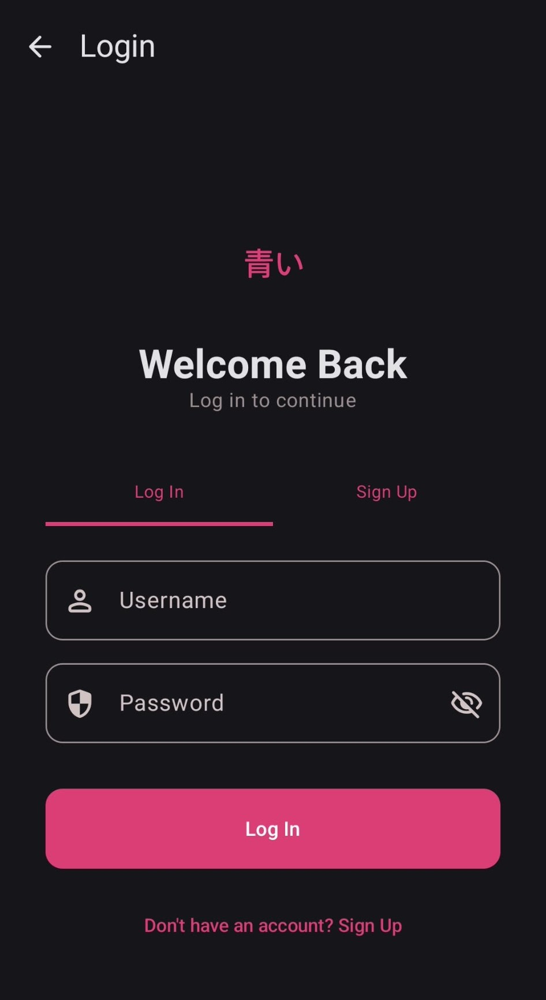
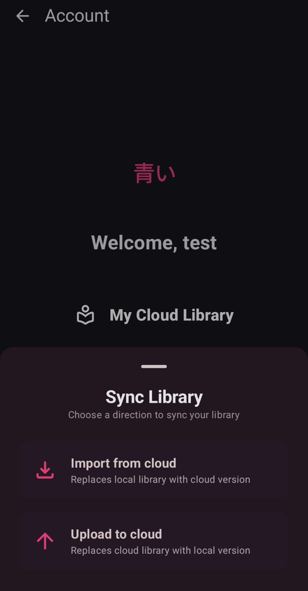

<div align="center">


# Aoi

A modern manga & manhwa reader for Android — clean, fast, and built around an extension-based source system.

[](https://github.com/cardal013/aoi)
[](https://kotlinlang.org)
[](LICENSE)
[](#project-status)
[](https://github.com/cardal013/aoi/releases/latest)
[](https://github.com/cardal013/aoi/releases/latest)

[**Website**](https://aoi-mangas.vercel.app/) **•** [**Download**](https://github.com/cardal013/aoi/releases/latest)

</div>

---

## Screenshots

<p align="center">
  <table>
    <tr>
      <td></td>
      <td></td>
      <td></td>
    </tr>
  </table>
</p>

## What is Aoi

Aoi is built on top of [Mihon](https://github.com/mihonapp/mihon), adding a dedicated backend and database layer on top of it. Instead of keeping everything only on-device, Aoi adds user accounts (username, profile, and related data) and a proper per-manga reading-status system, so your library isn't just a flat list — it's organized the way you actually read.

## Features

||Feature|Description|
|-|-|-|
|👤|**User accounts**|Sign in and keep your library and reading status tied to your profile instead of just the device.|
|🗂️|**Reading status categories**|Save each manga as Reading, Completed, Dropped, or Plan to Read.|
|📖|**Clean, focused reader**|Inherited from Mihon.|
|☁️|**Cloud-backed library**|Backed by a database — access your library from the website too.|
|🔄|**Automatic sync**|Your library, reading status and progress sync on their own: changes go up a few seconds after you make them and the app pulls what changed in the cloud when it opens. Your anime list syncs the same way.|
|📌|**Plan to Read by default**|New manga added to your library start in *Plan to Read*.|
|📺|**Anime list**|Keep the anime you watch, want to watch or finished in the *Watch* tab of the bottom bar. It uses your MyAnimeList anime list (never the manga list), with folders for seasons and your own order.|
|💾|**Backup**|*More → Backup* imports a backup file or exports your library to one.|

### Reading status categories

|Status|Meaning|
|-|-|
|📖 Reading|Currently in progress|
|✅ Completed|Finished reading|
|❌ Dropped|Stopped, not continuing|
|📌 Plan to Read|Saved for later|

### Anime

Open *Watch* in the bottom bar and tap *Connect MyAnimeList* once. At the top you pick *Plan to Watch* or *Completed*; tap **+** to search MyAnimeList and add one, or long-press results to add several at once (inside a folder, they go into that folder). Tapping an anime lets you change its status, count the episodes you've watched (the last one marks it *Completed*) or remove it; every change goes to MyAnimeList. Long-press an anime to put it in a folder, or long-press and move to drag it. The website has the same list.

### How the sync works

- Opening the app, logging in or getting back online pulls what changed in the cloud since the last sync, then sends what changed on the device.
- Every local change (library entries, reading status, chapter read/page) is marked on the device and sent about 5 seconds later, in batches. Reading progress is also sent live while you read.
- The sync remembers the time of its last success; if something fails, the next sync sends it again.
- The first sync of an account on a device merges both libraries: nothing is deleted and read progress never goes backwards.
- If manga in your library are no longer in the cloud (removed on another device), the app asks before removing them here.
- Read progress for chapters that aren't on the device yet (a manga that just came from the cloud) is kept and applied as soon as the chapters load.
- Nothing in the app wipes the cloud: there is no full resync.


## Installation

Download the latest APK from the [Releases page](https://github.com/cardal013/aoi/releases/latest) (or straight from the [website](https://aoi-mangas.vercel.app/)) and install it on your Android device.

<!-- TODO: add a Play Store badge here if/when Aoi is published -->

## Building from source

1. JDK 21 and the Android SDK (Android Studio's bundled JDK works).
2. Create `ignorance/local.properties` (git-ignored) with your Supabase project:
   ```properties
   SUPABASE_URL=https://<project>.supabase.co
   SUPABASE_ANON_KEY=<anon key>
   ```
   Without it the app builds but cannot connect to the cloud.
3. Run the SQL in [`supabase/migrations`](supabase/migrations) on your Supabase project, in order (incremental import and row level security). [`supabase/rls_check.sql`](supabase/rls_check.sql) shows the current tables, policies and grants without changing anything.
4. Build:
   ```powershell
   .\gradlew.bat :app:assembleDebug     # app/build/outputs/apk/debug/app-universal-debug.apk
   .\gradlew.bat assembleRelease        # needs keystore.properties + the keystore
   ```
   The debug build installs next to the release one (`com.cardal.aoi.dev`).

## Changelog

### 0.34.1
- The web links for the site are sent again once all the library's extensions are installed (fresh installs sent them empty)

### 0.34.0
- Site: read your manga on the source's site (*Continue: Chapter N*, *Open on <source>*, chapter list with ✓) and mark chapters read when you come back; the app sends the web links and every chapter

### 0.33.1
- Recommended anime extensions: 2Dhive, Anikoto and Lunar; on the site, *Watch* asks which of the three (or your own site) to open

### 0.33.0
- Many more anime extensions work (SalmanBappi ones, newer ext-lib 16 ones, videos split across servers); recommended extensions: Re:ANIME, KickAssAnime and Anikoto; English subtitles by default

### 0.32.3
- *Watch*: pill switch for the statuses and compact covers with progress; *Anime extensions*: magnifier in the top bar

### 0.32.2
- *Watch*: *Plan to Watch* and *Completed* as full-width tabs with counts (the status bar was hidden under the top bar)

### 0.32.1
- A broken anime extension no longer closes the app; if one does, *Watch* offers to uninstall it. *Watch episodes* shows the episodes, the ▶ on the cover plays

### 0.32.0
- Bottom bar: *Read* (manga) and *Watch* (anime list and folders) in place of *Library* and *History* (History is in *More*)
- ▶ on anime and folder covers opens the next episode; search bar in *Anime extensions*; offer to install recommended extensions when none is installed
- Website: *Watch episode N* opens the episode on a streaming site you choose and, when it should be over, asks if you watched it to the end and marks it on MyAnimeList; covers per row (*Cols*); phone menu fixed

### 0.29.0
- Watch and download anime from your MyAnimeList list, with Aniyomi extensions and a player inside the app (episodes count on MyAnimeList)

### 0.28.0
- *Admin → Trello*: your Trello boards inside the Admin, in the app and on the website (drag cards, lists, labels, due dates, checklists, comments, attachments, calendar)
- *Admin → Savearth*: select several days at once (press and hold, then drag or tap) to add or delete hours
- Website: *Admin* tab for admins, with everything the app has plus *Users*
- *Refeições* moved into the Admin, per account and on the website too, with a button to clear everything; the reminder was removed
- IPMA weather widget (Porto) for the home screen

### 0.27.0
- *Refeições* reminder for admins, before each marked day (how many days before and at what time can be set below the calendar)

### 0.26.0
- *Refeições* in *More* (admins only): shared calendar of the days you have lunch at home (green) or not (red)

### 0.25.0
- Tutorial on first install: tap *More* twice to add extensions, then import a backup and create an account (both optional)

### 0.24.2
- *Recent*/*Manual* button to the left of the search icon in the *Anime* tab

### 0.24.1
- The app tells you when a new Aoi release is out and can download and install it (install this version by hand once)

### 0.24.0
- Anime have only *Plan to Watch* and *Completed* (*Watching* becomes *Plan to Watch*, also on MyAnimeList); the last episode marks an anime *Completed*
- Add several anime at once from the search, and add straight into a folder with *+*
- *Recent*/*Manual* button next to the search icon
- Website: the same changes

### 0.23.0
- *Anime* tab with your MyAnimeList anime list instead of AniList (connect once; the manga list is never touched), with folders for seasons and *Recent*/*Manual* order
- *Users* in *Account* for admins
- Website: the same MyAnimeList list and folders

### 0.22.0
- *Admin* in *More* for admin accounts: Savearth, Gits and Settings (same as the Aoc app), with the Savearth data saved to the cloud

### 0.21.0
- *Anime* tab in the library (after *Plan to Read*): Watching, Plan to Watch and Completed, with AniList search, episode count and cloud sync
- Read chapters synced from the cloud no longer show as unread on a new device; this version also recovers the progress lost before
- *More → Backup* with *Import* and *Export*
- Website: Anime tab to view, add, change and remove anime

### 0.20.9
- The app icon (blue square) shows when the app opens; the account screen logo is back to how it was

### 0.20.8
- Account: no *Advanced*/*Full resync*

### 0.20.7
- Automatic sync (on open, after login, whenever the connection comes back, and a few seconds after each change); no sync buttons, the account screen only shows when it last synced
- The first sync on a device merges both libraries instead of overwriting one with the other
- Manga missing from the cloud are no longer removed from the device without asking
- Manga deleted from the local database (e.g. *Clear database*) are also removed from the cloud
- The app is always in English
- No more username or internal email in the logs; the website warns that passwords can't be recovered

### 0.20.5
- Incremental sync with the cloud (only what changed), with a *Full resync* button
- *Import from cloud* only pulls what changed, paginated
- New manga go to *Plan to Read* by default
- Local database migration (dirty tracking for the sync) and a Supabase migration (`user_library.updated_at`)

### 0.20.4
- Import no longer removes local chapters when a source fails
- Import reads progress in pages of 1000 rows

## Built with


## Project status


## Baseado no Mihon

O Aoi é um fork do [Mihon](https://github.com/mihonapp/mihon), distribuído sob a licença [Apache 2.0](LICENSE) (a mesma do Mihon). O leitor, as extensões e as fontes vêm do Mihon; o Aoi acrescenta contas, estados de leitura e a biblioteca na cloud. Obrigado à equipa do Mihon e aos seus contribuidores.

A API das fontes de anime (`source-api/.../animesource`) e a forma de carregar as extensões de anime vêm do [Aniyomi](https://github.com/aniyomiorg/aniyomi), também Apache 2.0. Obrigado à equipa do Aniyomi.

## Disclaimer

Aoi is a reader, not a content host. It does not distribute or store any manga, manhwa or anime itself; all content is retrieved at request time from the sources you choose to enable.

---

<p align="center">
  <a href="https://aoi-mangas.vercel.app/">Website</a> •
  <a href="LICENSE">License</a>
</p>

